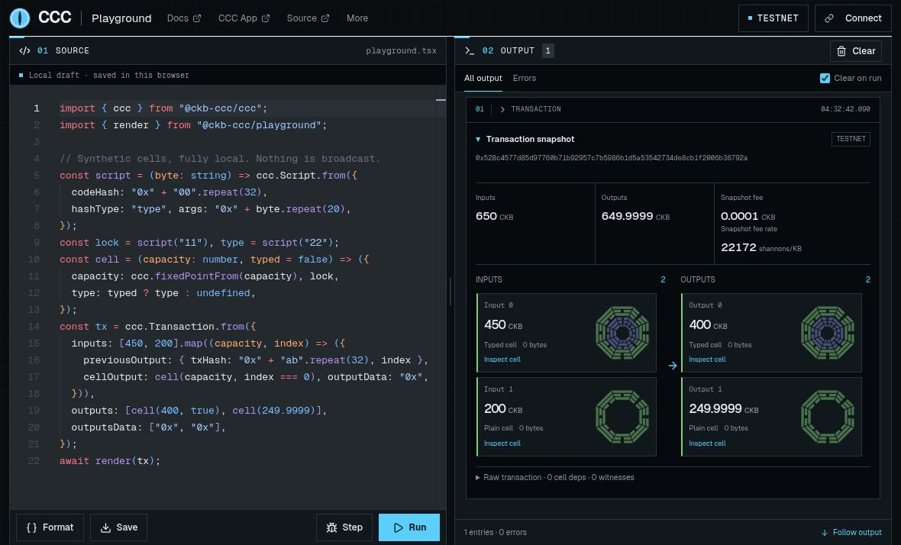

<p align="center">
  <a href="https://live.ckbccc.com/">
    
  </a>
</p>

<h1 align="center" style="font-size: 48px;">
  CCC Playground
</h1>

<p align="center">
  
  
  <a href="https://live.ckbccc.com/"></a>
  <a href="https://app.ckbccc.com/"></a>
  <a href="https://docs.ckbccc.com/"></a>
</p>

<p align="center">
  "CCC - CKBers' Codebase" is the next step of "Common Chains Connector".
  <br />
  Empower yourself with CCC to discover the unlimited potential of CKB.
  <br />
  Interoperate with wallets from different chain ecosystems.
  <br />
  Fully enabling CKB's Turing completeness and cryptographic freedom power.
  <br />
  Start exploring CKB from CCC playground!
</p>

## Preview

<p align="center">
  <a href="https://live.ckbccc.com/">
    
  </a>
</p>

This project is still under active development, and we are looking forward to your feedback. [Try it now here](https://live.ckbccc.com/).

## Documents

- Check [the repo of project CCC](https://github.com/ckb-devrel/ccc) for detailed introduction.
- [Documents site](https://docs.ckbccc.com).
- [API reference](https://api.ckbccc.com).

## Run Locally

```shell
# Navigate to the project directory
pnpm install
pnpm build
```

Open [http://localhost:3000](http://localhost:3000) with your browser to see the result.

## Workbench

- Edit TypeScript or TSX on the left and inspect rich output on the right. Drag the divider (or use its arrow keys) to change the split. On narrow screens, switch between Code and Output.
- **Run** advances through `await render(...)` checkpoints automatically. **Step** pauses at each checkpoint; **Continue** or **Ctrl/Cmd + Enter** advances. The editor, network and wallet controls stay locked during execution so a run has one source and network context.
- `console.log`, `console.error`, transactions, cells, addresses, scripts, bytes, bigints and React elements remain supported. Transaction output is snapshotted at each render, so later mutations do not rewrite earlier stages.
- **Load source** accepts raw HTTP(S) URLs and `nostr:nevent…` references, including existing `?src=` links. Loading never executes code. Imported scripts do not overwrite the saved local draft; restore that draft from Load source, or download any editor contents with Save.
- **Share** publishes to public Nostr relays and verifies that the source can be retrieved before offering a copyable link. Never publish credentials. A failed read-back does not mean every relay rejected the event, and relay storage is not permanent.
- **Clear on run** starts a fresh output timeline by default. Turn it off to compare runs. Errors can be filtered independently; automatic output following can be disabled while inspecting earlier entries.

Concurrent `await render(...)` checkpoints advance in creation order. Once the top-level script ends, unawaited checkpoints no longer advance; this is not cancellation of arbitrary JavaScript. Browser history source changes wait until the active run settles.

Code runs in the page, not a security sandbox. Only run code you trust. It can use the selected client and signer, and arbitrary JavaScript cannot be reliably interrupted by this UI. Examples load the current CCC repository sources from `master` through the same confirmation flow. Loading does not run code. The CKB, xUDT and Spore transfer examples preview unsigned transactions; available assets depend on the selected wallet and network. The initial editor code is unchanged.

### Development checks

From the repository root:

```sh
pnpm install --frozen-lockfile
pnpm --filter '@ckb-ccc/ccc-playground^...' build
pnpm --filter @ckb-ccc/ccc-playground test
pnpm --filter @ckb-ccc/ccc-playground lint
pnpm --filter @ckb-ccc/ccc-playground exec tsc --noEmit
pnpm --filter @ckb-ccc/ccc-playground build
pnpm --filter @ckb-ccc/ccc-playground dev
```

The focused tests cover transaction snapshot isolation and Nostr loading/relay cleanup without publishing test events to public relays. Wallet signing and relay availability also need live integration checks when those integrations change.

### Workspace layout

The compact toolbar keeps the editor and output primary. On desktop, drag the
separator from 20–80%, use its arrow keys, or reset with Home / double-click.
The prominent Hide tools / Show tools control stays in the collapsible bottom dock and never
hides the active network and wallet. These layout preferences are saved separately from source.
Phones use full-width Code / Output tabs. Panels scroll independently; the
workspace never auto-collapses while scrolling. Dialogs stay centered, scroll
within the viewport and retain a reachable close control. Reduced-motion
preferences disable decorative motion.

Output follows new entries by default with smooth panel-only scrolling. Scrolling
up by wheel, touch or keyboard pauses following immediately; the Follow output
control resumes it. Reduced motion uses immediate scrolling instead.

### Wallet-required code

`client`, `render` and `console` work without a wallet. Importing or assigning
`signer` alone does not require a connection; actually reading signer state or
calling a signer method without a wallet raises `MissingWalletError`. The output
offers Connect wallet and Use example wallet. Without a wallet extension, choose
the read-only example wallet, then press Run again. Connecting never resumes
execution automatically. Build a transfer accepts either wallet option and does
not broadcast; signing or sending requires a real wallet. No demo wallet identity is silently substituted.

Clear output resets Follow output to enabled. While following, the control reads
Following output in gray; when paused, Follow output is blue and resumes it.

Run and Clear output resume following. Scrolling down to the bottom resumes it;
scrolling upward pauses it without moving the document. On narrow screens Monaco
uses larger text, wrapping and a smaller gutter; automatic suggestion popups are
disabled, while syntax highlighting and the existing TypeScript diagnostics remain.
These settings do not claim to solve Monaco's mobile selection/IME limitations.

Transaction cells keep inputs and outputs side by side on desktop, with compact
independent grids and an accessible draggable separator. On phones, both counts
stay visible in a touch-sized Inputs/Outputs switch above a full-width list.
Nested lock/type fingerprints are decorative watermarks; script details remain
available in each cell. Mobile toolbar actions use one equal-width 44px-high row.
